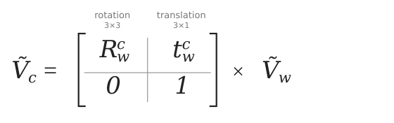
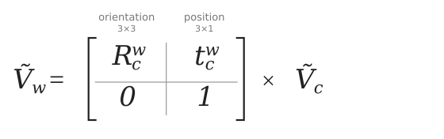
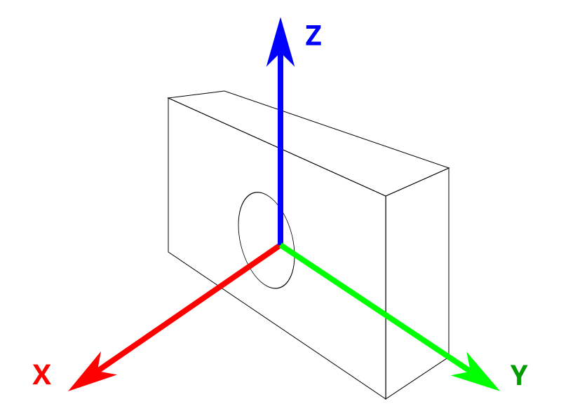
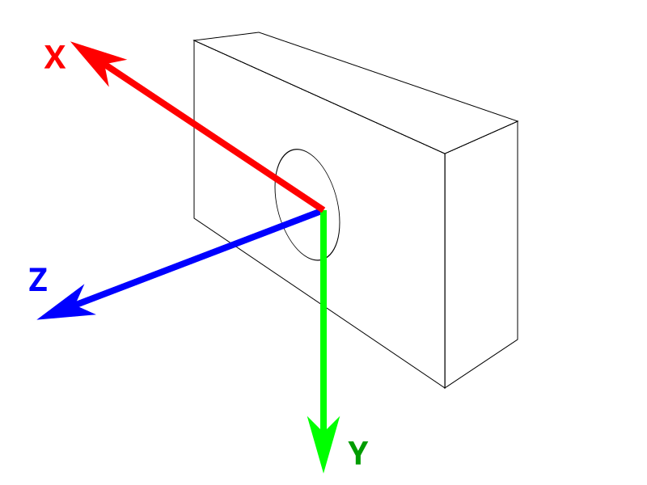
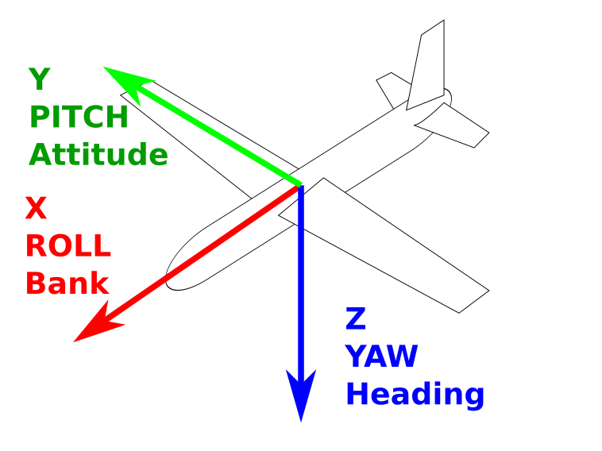
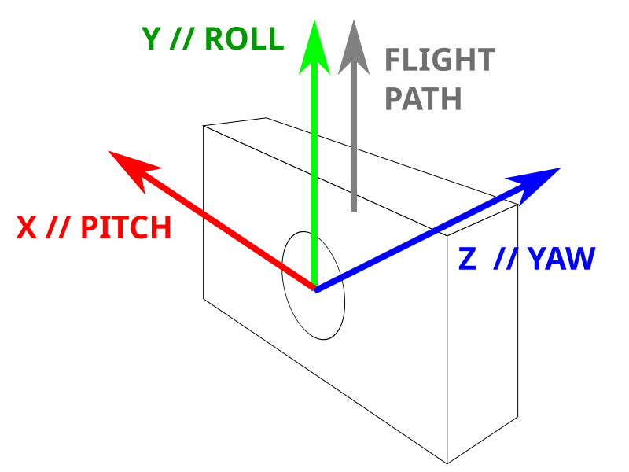
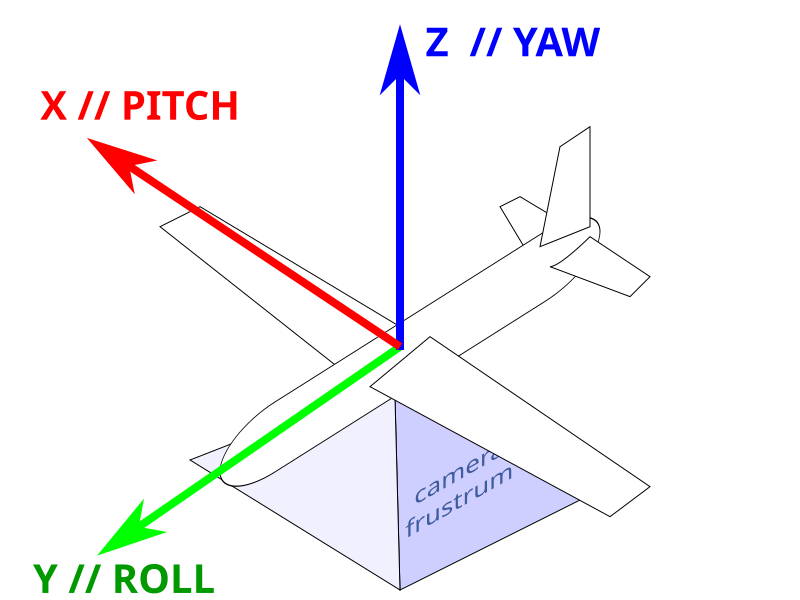

= Camera obscura
:author: Julien Morat
:email: julien.morat@gmail.com
:sectnums:
:toc:
:toclevels: 2
:experimental:

== Reference frames

=== Notations

* *points* are column vectors: `V = {startsb}X, Y, Z{endsb}^T^`,
* points in *world* (resp. *camera*) frame are denoted `V~w~` (resp. `V~c~`),
* *pose* is the *position* and *orientation* of the camera in the world, denoted `Q`,
* *position* is the coordinate of an object (e.g. the camera center) in the world, a 3-vector denoted `t^w^~c~`,
* *orientation* is the attitude of an object in the world, a 3x3 rotation matrix denoted `R^w^~c~`,
* *transform* is the inverse of the pose, decomposed into a *translation* and a *rotation*,
* *translation* is a 3-vector denoted `t^c^~w~`,
* *rotation* is a 3x3 rotation matrix denoted `R^c^~w~`.

The *pose* maps *camera to world*:

`V~w~ = R^w^~c~ V~c~ + t^w^~c~` (1)

The *transform* maps *world to camera*:

`V~c~ = R^c^~w~ V~w~ + t^c^~w~` (2)

NOTE: with `V~c~ = 0` in (1), `V~w~ = t^w^~c~`: the position part of the pose is the camera center in the world.
The translation `t^c^~w~` of the transform is *not* the camera center.

=== Homogeneous notation

In *homogeneous coordinates*, an additional value is added:
3D points have 4 coordinates, denoted `Ṽ = {startsb}X, Y, Z, W{endsb}^T^`.
Two points are equivalent (denoted ≈) if they are equal up to a scale factor.
Pose and transform then become 4x4 matrices, written by blocks:

.Transform: world to camera

.Pose: camera to world

=== Pose / transform conversion

From (1):

[%hardbreaks]
`V~w~ - t^w^~c~ = R^w^~c~ V~c~`
`(R^w^~c~)^T^ (V~w~ - t^w^~c~) = V~c~`
`V~c~ = (R^w^~c~)^T^ V~w~ - (R^w^~c~)^T^ t^w^~c~` (3)

From (2) and (3):

`R^c^~w~ = (R^w^~c~)^T^` and `t^c^~w~ = -(R^w^~c~)^T^ t^w^~c~`

and similarly:

`R^w^~c~ = (R^c^~w~)^T^` and `t^w^~c~ = -(R^c^~w~)^T^ t^c^~w~`

=== Change of reference frame of a pose

Given the *pose* of a camera in reference frame `α`, express it in frame `β`, i.e. find:

`V~βw~ = R^βw^~βc~ V~βc~ + t^βw^~βc~`

Assuming `α` and `β` differ by a pure *rotation* (same origin, same scale, same handedness, ...)
denoted `R^α^~β~` and `R^β^~α~`:

`V~β~ = R^β^~α~ V~α~` and `V~α~ = R^α^~β~ V~β~` (4)

From (1) in `α`, then (4):

[%hardbreaks]
`V~αw~ = R^αw^~αc~ V~αc~ + t^αw^~αc~`
`V~αw~ = R^αw^~αc~ R^α^~β~ V~βc~ + t^αw^~αc~`
`R^β^~α~ V~αw~ = R^β^~α~ (R^αw^~αc~ R^α^~β~ V~βc~ + t^αw^~αc~)`
`V~βw~ = (R^β^~α~ R^αw^~αc~ R^α^~β~) V~βc~ + R^β^~α~ t^αw^~αc~` (5)

Consequently:

`R^βw^~βc~ = R^β^~α~ R^αw^~αc~ R^α^~β~` and `t^βw^~βc~ = R^β^~α~ t^αw^~αc~`

== Axis conventions

=== Summary

[%header,cols="<2e,3*^1m"]
|===
| convention              | X     | Y     | Z
| Gaming                  | front | left  | up
| OpenMVG, KITTI, 7Scenes | right | down  | front
| Tait-Bryan              | front | right | down
| Photoscan camera        | right | up    | back
| Photoscan UAV           | pitch | roll  | yaw
|===

=== Gaming

.Gaming axis: X => front, Y => left, Z => up

=== OpenMVG, KITTI, 7Scenes

.OpenMVG camera axis: X => right, Y => down, Z => front

KITTI and 7Scenes use the same camera axis as OpenMVG.

=== Tait-Bryan (aerial)

.Tait-Bryan common axis: X => front, Y => right, Z => down

The (yaw, pitch, roll) triplet gives the attitude of the plane in the world:
it transforms a point in the plane frame `P~c~` into the world frame `P~w~`:

`P~w~ = R~yaw~ × R~pitch~ × R~roll~ × P~c~`

=== Photoscan

.Photoscan camera axis: X => right, Y => up, Z => back

.Photoscan UAV rotation axis: X => pitch (uav-right), Y => roll (uav-front), Z => yaw (uav-up)

WARNING: Photoscan is a beach: *(yaw, pitch, roll) does not refer to the camera*
apparatus, but to the plane. The camera is considered fixed below the plane,
so with null (yaw, pitch, roll), the camera is looking down, top border towards north.

== Sensors

[%header,cols="<3,4*>1m"]
|===
| name                                                              | diag (mm) | width (mm) | height (mm) | area (mm²)

5+h| Cinema film
| IMAX film frame                                                   |     87.91 |      70.41 |       52.63 |       3706
| Standard 65mm film frame                                          |     57.30 |      52.48 |       23.01 |       1208
| Super 35mm film 4 Perf                                            |     31.11 |      24.89 |       18.66 |        464
| 35mm 3 Perf                                                       |     28.48 |      24.89 |       13.86 |     344.97
| Standard 35mm film frame                                          |     27.20 |       22.0 |        16.0 |        352
| Super 35mm 2 Perf                                                 |     26.58 |      24.89 |        9.35 |      232.7
| 35mm 2 Perf Techniscope                                           |     23.85 |      21.95 |        9.35 |     205.23
| Super 16mm film frame                                             |     14.54 |      12.52 |        7.41 |      92.80
| Standard 16mm film frame                                          |      12.7 |      10.26 |        7.49 |      76.85
| Super 8mm film frame                                              |      7.04 |       5.79 |        4.01 |      23.22
| Standard 8mm film frame                                           |      5.94 |        4.8 |         3.5 |       16.8

5+h| Medium & large format
| Large Format Film 8x10                                            |       325 |        254 |         203 |      51562
| Large Format Film 5x7                                             |       219 |        178 |         127 |      22606
| Large Format Film 4x5                                             |       155 |        121 |          97 |      11737
| Medium Format Film 6x7                                            |        87 |         67 |          56 |       3752
| Medium Format Film 6x6                                            |        79 |         56 |          56 |       3136
| Medium Format Film 6x4.5                                          |        70 |         56 |          42 |       2352
| Phase One P 65+, IQ160, IQ180                                     |     67.40 |      53.90 |       40.40 |       2178
| Hasselblad H5D-60                                                 |     67.08 |       53.7 |        40.2 |       2159
| Leaf AFi 10                                                       |     66.57 |         56 |          36 |       2016
| Kodak KAF 39000 CCD                                               |     61.30 |         49 |       36.80 |       1803
| Pentax 645D                                                       |        55 |         44 |          33 |       1452
| Leica S                                                           |        54 |         45 |          30 |       1350

5+h| Full-frame, APS, 4/3, 1"
| 35mm full-frame (Canon EF, Nikon FX, Sony α, Sony FE)             | 43.1–43.3 |    35.8–36 |     23.9–24 |    856–864
| Canon APS-H                                                       |     33.50 |      27.90 |       18.60 |        519
| APS-C (Sony, Nikon DX, Pentax K, Samsung NX, Fuji X)              | 28.2–28.4 |  23.6–23.7 |       15.60 |    368–370
| APS-C Canon (EF-S)                                                |     26.82 |      22.30 |       14.90 |        332
| Sigma Foveon X3 (original)                                        |     24.90 |      20.70 |       13.80 |        286
| Blackmagic Production Camera 4K                                   |     24.23 |      21.12 |       11.88 |        251
| 1.5" (Canon PowerShot G1 X Mark II)                               |     23.36 |      18.70 |          14 |        262
| Four Thirds / Micro Four Thirds                                   |     21.60 |      17.30 |          13 |        225
| Blackmagic Cinema Camera EF                                       |     18.13 |      15.81 |        8.88 |        140
| 1" (Digital Bolex d16)                                            |     16.00 |      12.80 |        9.60 |        123
| 1" (Sony RX100, RX10, Nikon CX, Samsung NX Mini)                  |     15.86 |      13.20 |        8.80 |        116
| Blackmagic Pocket Cinema / Studio Camera                          |     14.32 |      12.48 |        7.02 |       87.6

5+h| Small sensors (1/x")
| 1/1.2" (Nokia 808 PureView)                                       |     13.33 |      10.67 |        8.00 |      85.33
| 2/3" (Nokia Lumia 1020, Fujifilm X-S1, X20, XF1)                  |     11.00 |       8.80 |        6.60 |      58.10
| 1/1.6"                                                            |     10.07 |       8.08 |        6.01 |      48.56
| 1/1.7" (Pentax Q7, Canon G10, G15)                                |      9.50 |       7.60 |        5.70 |      43.30
| 1/1.8" (Nokia N8, Olympus C-5050, C-5060, C-7070)                 |      8.93 |       7.18 |        5.32 |      38.20
| 1/2" (Fujifilm HS30EXR, Espros EPC 660)                           |      8.00 |       6.40 |        4.80 |      30.70
| 1/2.3" (Sony Exmor IMX220)                                        |      7.87 |       6.30 |        4.72 |      29.73
| 1/2.3" (Pentax Q, Sony DSC-W330, GoPro Hero 3, Panasonic HX-A500) |      7.66 |       6.17 |        4.55 |      28.07
| 1/2.5" (Nokia Lumia 1520, Sony Cyber-shot DSC-T5)                 |      7.18 |       5.76 |        4.29 |      24.70
| 1/2.7"                                                            |      6.72 |       5.37 |        4.04 |      21.70
| 1/3" (iPhone 5S, iPhone 6)                                        |      6.00 |       4.80 |        3.60 |      17.30
| 1/3.2" (iPhone 5)                                                 |      5.68 |       4.54 |        3.42 |      15.50
| 1/3.6" (Nokia Lumia 720)                                          |      5.00 |       4.00 |        3.00 |       12.0
| 1/4"                                                              |      4.00 |       3.20 |        2.40 |       7.68
| 1/6"                                                              |      3.00 |       2.40 |        1.80 |       4.32
| 1/8"                                                              |      2.00 |       1.60 |        1.20 |       1.92
| 1/10"                                                             |      1.60 |       1.28 |        0.96 |       1.23
|===
